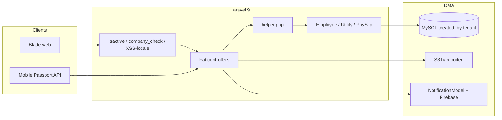
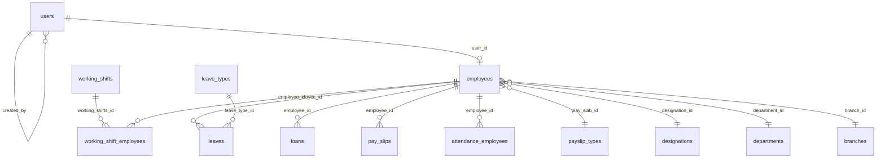
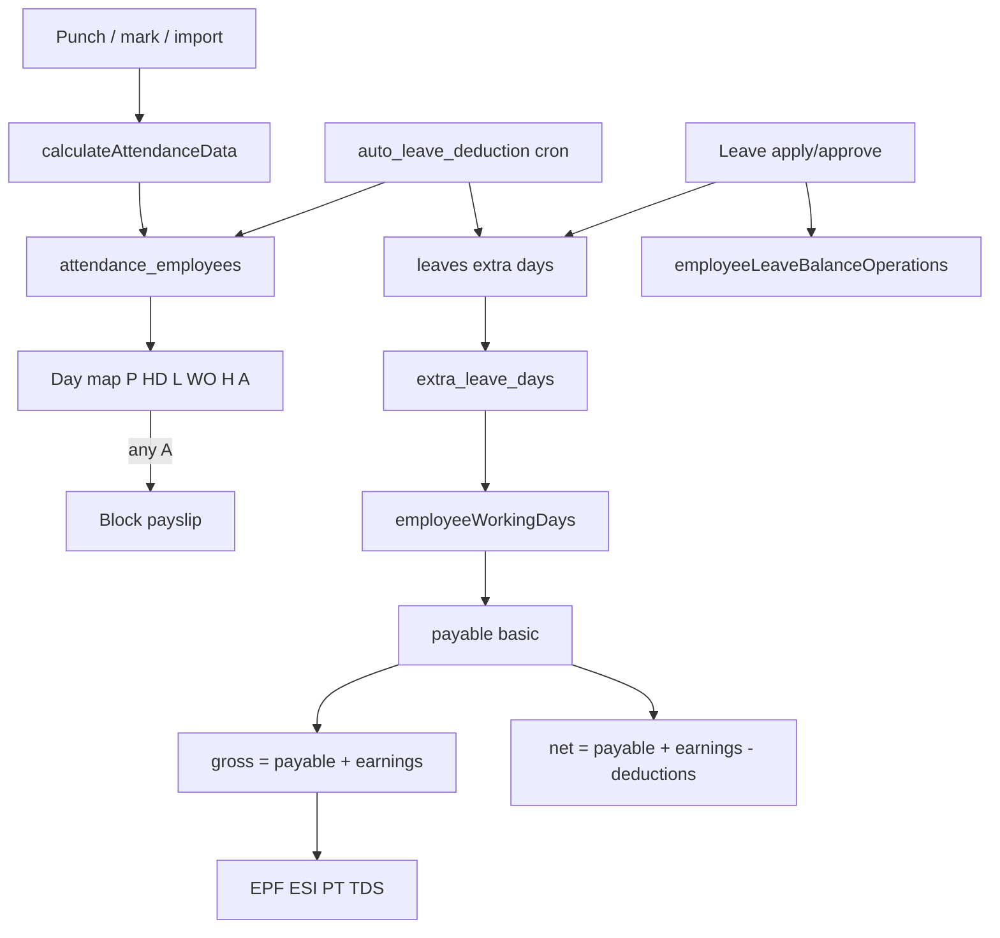

# HR Shastri — Production Takeover Audit

**Project:** HR Shastri (Laravel HRMS)  
**Scope:** Read-only forensic reverse engineering of the local codebase  
**Date:** 20 August 2026  
**Method:** Source inspection only. No application code was modified.  
**Labels:** **FACT** = observed in code · **INFERENCE** = reasoned from patterns · **UNKNOWN** = not confirmed

> This document is for the developer taking ownership with no KT. Production is live. Treat payroll, leave, attendance, tenant isolation, and the public attack surface as load-bearing.

**Companion view:** Cursor canvas `hr-shastri-takeover-audit.canvas.tsx` (executive dashboard).

---

## Table of contents

1. [Executive summary](#1-executive-summary)
2. [Act first — security](#2-act-first--security)
3. [Technology inventory](#3-technology-inventory)
4. [Architecture](#4-architecture)
5. [Directory map](#5-directory-map)
6. [Users, roles, permissions](#6-users-roles-permissions)
7. [Module inventory](#7-module-inventory)
8. [Route audit](#8-route-audit)
9. [Controller audit](#9-controller-audit)
10. [Database and models](#10-database-and-models)
11. [Business rules](#11-business-rules)
12. [User journeys](#12-user-journeys)
13. [HR functional flows](#13-hr-functional-flows)
14. [Attendance → leave → payroll](#14-attendance--leave--payroll)
15. [API](#15-api)
16. [Jobs, events, scheduler](#16-jobs-events-scheduler)
17. [Integrations and configuration](#17-integrations-and-configuration)
18. [File storage](#18-file-storage)
19. [Reports and exports](#19-reports-and-exports)
20. [Error handling](#20-error-handling)
21. [Original vs custom](#21-original-vs-custom)
22. [Change impact](#22-change-impact)
23. [Regression test plan](#23-regression-test-plan)
24. [Do not touch](#24-do-not-touch)
25. [Unknowns and questions](#25-unknowns-and-questions)
26. [Takeover checklist](#26-takeover-checklist)

---

## 1. Executive summary

HR Shastri is a **multi-tenant Indian HRMS** built on **WorkDo HRMGo** (Laravel 9.42.2), then customized for about a year.

**What it does (FACT)**

- Company / branch / department / designation / employee master
- Employee self-service (profile, leave, WFH, short leave, gate pass, visits, claims, tickets)
- Attendance (web punch, mobile GPS punch, bulk, import)
- Leave balances, extra/unpaid days, auto-deduction cron
- Indian payroll: salary slab (`play_slab_id`), allowances, deductions, loans, EPF, ESI, PT, TDS, payslip PDF
- Recruitment, performance, training, assets, announcements
- Mobile app via Laravel Passport
- Leftover SaaS: super admin, plans, coupons, many payment gateways

Branding still says **HRMGo** in `resources/views/partial/Admin/companyMenu.blade.php`. `README.md` is the default Laravel readme and is not project documentation.

**How money actually works (FACT)**

Attendance helper → optional auto-leave cron → leave `extra_leave_days` → `PaySlipController::store`.  
There is a **second live engine** (`MyPaySlipController` + `Employee::get_net_salary`) with a different formula.

**How identity works (FACT)**

Three layers: `users.type` (`super admin` / `company` / `hr` / `employee`), Spatie roles/permissions, and employee flags (`employee_exit`, `web_login`, `app_login`). Tenant key is `User::creatorId()` / `created_by`.

---

## 2. Act first — security

| Severity | Finding | Location | Impact | Immediate action |
|---|---|---|---|---|
| CRITICAL | Phishing kit in public web root | `public/securityask/` | Credential/CC harvester if URL is reachable | Take offline; isolate host; rotate every secret |
| CRITICAL | Hardcoded AWS S3 keys | `config/filesystems.php` | Bucket/account compromise | Rotate keys; move to env; purge git history |
| CRITICAL | Firebase service-account JSON in repo | `config/firebase-credentials/project-hr-shastri.json` | Push abuse / GCP leak | Revoke key; store outside git |
| CRITICAL | Telegram bot token in phishing kit | `public/securityask/config.php` | Attacker exfil channel | Revoke bot; delete folder |
| CRITICAL | Unauthenticated payslip PDF | `GET payslip/pdf_api/{id}/{m}` | Salary IDOR | Require auth |
| CRITICAL | Unauthenticated Artisan | `GET /optimize`, `/clear-route` | Anyone can flush cache | Delete routes |
| CRITICAL | Unauthenticated cron / leave credit | `GET cron/*`, `add-monthly-leave*` | Duplicate leave, false absences | HTTP must not trigger these |
| HIGH | Any verified user can lock accounts | `inactive_user` / `active_user` | Account lockout | Add permission + tenant scope |
| HIGH | `PermissionController` / `RolesController` | Login only | Privilege change | Add Spatie checks |
| HIGH | API throttle disabled | `app/Http/Kernel.php` | Brute force / punch abuse | Re-enable throttle |
| HIGH | Claim files under `public/` | `public/fileupload/` | Guessable receipts | Move behind auth |
| HIGH | Seeder demo password `1234` | `UsersTableSeeder.php` | If those users exist in prod | Force reset |

**SECRET FOUND (type only — values not recorded here)**

| Location | Type |
|---|---|
| `config/filesystems.php` | AWS access key + secret |
| `config/firebase-credentials/project-hr-shastri.json` | Firebase private key |
| `public/securityask/config.php` | Telegram bot token + chat ID |
| `.env` (names only) | `APP_KEY`, `DB_PASSWORD`, `MAIL_PASSWORD`, `FIREBASE_SERVER_KEY`, `PUSHER_APP_SECRET`, `REDIS_PASSWORD` |

---

## 3. Technology inventory

Never guess a version. If unconfirmed: UNKNOWN.

| Component | Technology | Version | Purpose | Location | Risk |
|---|---|---|---|---|---|
| Framework | Laravel | **v9.42.2** | App core | `composer.lock` | HIGH — EOL |
| PHP requirement | PHP | **^8.0.2** | Composer constraint | `composer.json` | MEDIUM |
| PHP runtime | PHP | **UNKNOWN** | Host binary | `php -v` | NEEDS VERIFICATION |
| Database | MySQL (env name) | **UNKNOWN** | Primary store | `.env` `DB_CONNECTION` | HIGH |
| Cache default | file | config default | Cache | `config/cache.php` | MEDIUM |
| Session default | file | config default | Web login | `config/session.php` | MEDIUM |
| Queue default | sync | config default | Background work | `config/queue.php` | LOW — no Job classes |
| Mail | SMTP | UNKNOWN | HR emails | `config/mail.php` | HIGH |
| Storage | local + hardcoded S3 + Wasabi | UNKNOWN | Docs/logos | `config/filesystems.php` | CRITICAL |
| Auth web | Session | Laravel 9 | Browser | `config/auth.php` | CRITICAL |
| Auth API | Passport | **v11.8.4** | Mobile tokens | `config/auth.php` `api` | CRITICAL |
| Sanctum | Installed, unused | composer `^2.14.1` | Commented in API | LOW |
| Authorization | Spatie Permission | **5.7.0** + `users.type` | Roles | `User` HasRoles | CRITICAL |
| Frontend | Blade + Dash/Tabler + jQuery DataTables | **v10.11.0** | UI | views + yajra | MEDIUM |
| PDF | barryvdh/laravel-dompdf | **v2.0.1** | Payslips | composer.lock | MEDIUM |
| Excel | maatwebsite/excel | **3.1.40** | Import/export | `app/Exports` | HIGH |
| Chat | munafio/chatify | **v1.5.4** | Leftover | vendor | MEDIUM |
| Payments | Stripe, PayPal, Razorpay, Paytm, Mollie, Mercado, CoinGate, Skrill, Paymentwall, Paystack, Flutterwave | various | SaaS leftover | `*PaymentController` | HIGH leftover |
| SMS | arkitecht/laravel-twilio | `^1.0` | `Utility::send_twilio_msg` | MEDIUM |
| Calendar | spatie/laravel-google-calendar | `^3.5` | Events | Utility | MEDIUM |
| Captcha | anhskohbo/no-captcha | `^3.4` | Login | `RECAPTCHA_MODULE` | LOW |
| Ready-made script | WorkDo **HRMGo** SaaS | UNKNOWN script version | Original product | menus, plans, Utility | HIGH |
| Tests | Breeze stubs only | — | No HR tests | `tests/` | CRITICAL gap |

**FACT:** `app/Jobs`, `app/Events`, `app/Listeners`, `app/Notifications`, `app/Observers`, `app/Policies`, `app/Http/Requests` — **empty / missing**.

**FACT:** `.env.example` was **not found**.

---

## 4. Architecture



**Request path (FACT)**

```
Browser / Mobile
  → routes/web.php (session, CSRF, Isactive)
    or routes/api.php (Passport + smartThrottle 300/min)
    → Controller (inline Validator; Auth::user()->can() inconsistent)
      → helper.php / Employee static payroll methods / Utility::settings()
        → MySQL scoped by created_by
          → NotificationModel + Firebase / Mail templates
            → Blade DataTables or JSON
```

---

## 5. Directory map

| Path | Purpose | Risk | Origin |
|---|---|---|---|
| `app/Http/Controllers/` | ~115 active controllers; almost all business logic | CRITICAL | Mixed |
| `app/Http/Controllers/API/` | Mobile punch, leave, claims, profile | CRITICAL | CUSTOM |
| `app/Models/` | 140+ models; payroll math on `Employee` | CRITICAL | Mixed |
| `app/Models/Utility.php` | Settings, email, upload, old payslip | CRITICAL | ORIGINAL + MODIFIED |
| `app/helper.php` | Attendance calc, leave-for-payslip, working days | CRITICAL | CUSTOM |
| `app/Http/Middleware/` | `Isactive`, `company_check`, `XSS` (locale only), `smartThrottle` | HIGH | Mixed |
| `routes/web.php` | ~2100 lines | CRITICAL | Mixed |
| `routes/api.php` | Passport mobile API | CRITICAL | CUSTOM |
| `database/migrations/` | Original HRMGo schema only | HIGH — behind live DB | ORIGINAL |
| `database/seeders/UsersTableSeeder.php` | Demo roles/users | HIGH — not live source of truth | ORIGINAL |
| `resources/views/partial/Admin/` | Menus by type | HIGH | Mixed |
| `app/Exports/` | 28 Excel classes | HIGH | Mixed |
| `app/Mail/` | 15 mailables | MEDIUM | ORIGINAL |
| `app/Console/Commands/` | 1 command: auto leave deduction | CRITICAL | CUSTOM |
| `public/securityask/` | **Not HR — phishing kit** | CRITICAL | Malicious |
| `storage/uploads/` | Docs, samples | HIGH | Mixed |
| `tests/` | Breeze examples | HIGH gap | ORIGINAL |

**FACT:** Backup copies live in the tree (`--bk--`, `__25-12-2023`, etc.). Filename ≠ current behavior.

---

## 6. Users, roles, permissions

### How identity works (FACT)

1. **`users.type`** — `super admin`, `company`, `hr`, `employee`
2. **Spatie** — `can('Manage Leave')`, `@can`, `hasPermissionTo`
3. **Employee row** — `user_id`, `employee_exit`, `web_login`, `app_login`, manager `assign_employees`

`User::creatorId()`: company / super admin → own `id`; everyone else → `created_by`.

### Seeded roles (FACT — `UsersTableSeeder.php`)

| Role / type | Typical access | Notes |
|---|---|---|
| super admin | Companies, plans, coupons, system settings | Not day-to-day HR |
| company | Full HR/payroll if permissions granted | Redirect to `wizard_form` if branch name empty |
| hr | Large HR subset | Live perms may differ |
| employee | Self-service + my payslip / leave | Web/app login flags |
| custom Spatie roles | Whatever `RolesController` assigned | **DB is source of truth** |

Demo users in seeder: `superadmin@example.com`, `company@example.com`, `hr@example.com` with password hash of `1234`. Whether they exist in production is **UNKNOWN**.

### Middleware (FACT)

| Middleware | Real behavior |
|---|---|
| `Isactive` (web group) | Logout if `login_status=0`, `employee_exit=1`, or `web_login!=1` |
| `company_check` | Company users with empty branch name → wizard |
| `XSS` | Sets locale only. **Does not sanitize XSS** |
| `smartThrottle` | 300 req/min per user or IP (API group) |
| `CheckPlan` | Alias registered; **class file missing**; unused on routes |
| API group | Sanctum and `throttle:api` **commented out** |

### Authorization gaps (FACT)

- Menu uses Blade `@can` / `Gate::check` — UI hide is not enforcement
- `MyPaySlipController`: `can('My Pay Slip') || true`
- `PaySlipController::store`: custom-cycle permission `|| true`
- Visit/claim request menu items gated by **`Manage Resignation Request`** (`companyMenu.blade.php`)
- Employee WFH / short leave / gate pass shown for `type == employee` without `@can`
- `inactive_user` / `active_user`: no Manage User check
- `PermissionController` and `RolesController`: no Spatie checks

### Role → module (menu + seeder)

| Module | company / hr (if permitted) | employee |
|---|---|---|
| Employees | Yes | Own profile |
| Payroll generate | Yes | My Payslip if permission |
| Attendance / leave / timesheet | Yes | Own + apply |
| WFH / short leave / gate pass | Request queues | Apply |
| Visits / claims | Request + approved claims | Own lists |
| Reports | Manage Report | No |
| Settings | Company / system setup | No |
| Recruitment / performance / training | If permitted | Training list if type employee |
| SaaS plans | Super admin / company leftover | No |

---

## 7. Module inventory

Only modules found in code/menu.

### Organization

| Module | Controllers | Origin | Risk |
|---|---|---|---|
| Company wizard | `CompanyDetailsLogin` | CUSTOM | HIGH |
| Branch / Dept / Designation | matching | ORIGINAL + geo custom | HIGH |
| Location / Grade / Category / Commute / City tier | matching | CUSTOM | MEDIUM |
| Working shifts | `WorkingShiftsController` | CUSTOM | CRITICAL |
| Legacy `ShiftController` | stub; routes commented | ORIGINAL | LOW |

**FACT:** Menu label “Grade Type” points at `visit_type.index`; “Assign Grade” at `grade_type.index`.

### People and HR events

| Module | Notes | Origin | Risk |
|---|---|---|---|
| Employee | God class; Indian statutory; hard-delete user+files | MODIFIED | CRITICAL |
| Users / Roles | Two role UIs (`RoleController` Spatie, `RolesController` `roles_managment`) | MODIFIED | CRITICAL |
| Documents / letters | Joining, relieving, NOC, increment, offer | MIXED | HIGH |
| Transfer / Promotion | In menu | ORIGINAL | MEDIUM |
| Resignation / Termination | + request queues | MODIFIED | HIGH |
| Award / Warning / Travel | **Routes exist, removed from current sidebar** | ORIGINAL | MEDIUM orphan |
| Complaint / Ticket | Grievance Desk | ORIGINAL | MEDIUM |
| Announcement / Event / Holiday / Policy | In menu | ORIGINAL | MEDIUM |

### Time

| Module | Notes | Origin | Risk |
|---|---|---|---|
| Attendance | Punch, bulk, import (import class missing) | MODIFIED | CRITICAL |
| Timesheet | + approval | ORIGINAL | MEDIUM |
| Leave | Apply, request, balances, extra days | MODIFIED | CRITICAL |
| Short leave | Early/late; table `cearly_late_comming_leave` | CUSTOM | HIGH |
| WFH | `apply_wfm`; **not in payroll** | CUSTOM | HIGH |
| Gate pass | `get_pass` | CUSTOM | MEDIUM |
| Overtime master | Payslip reads this table, not punch OT | ORIGINAL | HIGH |
| Week-off | Company settings + employee JSON | CUSTOM | CRITICAL |

### Payroll

| Module | Notes | Origin | Risk |
|---|---|---|---|
| Pay slab | `play_slab_id` → `payslip_types` | MODIFIED | CRITICAL |
| Allowance / commission / other / deduction options | Slab-scoped | MODIFIED | CRITICAL |
| Set salary | Legacy component UI still present | ORIGINAL | CRITICAL |
| Loan | Installments on new engine | MODIFIED | HIGH |
| Statutory PF/ESI/PT | Custom Indian tables | CUSTOM | CRITICAL |
| Generate payroll | `PaySlipController` | HEAVILY CUSTOM | CRITICAL |
| My payslip | Old formula | CUSTOM | HIGH |

### Other

| Module | Origin | Risk |
|---|---|---|
| Visits & claims | CUSTOM | HIGH |
| Recruitment / interview / onboard | ORIGINAL + job references custom | MEDIUM |
| Performance / training | ORIGINAL | LOW–MEDIUM |
| Finance accounts | ORIGINAL SaaS | MEDIUM |
| Assets | ORIGINAL | MEDIUM |
| Reports | MIXED | HIGH |
| Mobile menu / geofencing | CUSTOM | HIGH |
| Settings / email templates / IP restrict | MODIFIED | CRITICAL |
| Zoom / Chatify / plans / payments | ORIGINAL leftover | MEDIUM–HIGH |

---

## 8. Route audit

`web.php` is too large to list line-by-line. High-signal facts:

### Unauthenticated / destructive

| Method | URL | Risk |
|---|---|---|
| GET | `/optimize`, `/clear-route` | CRITICAL — Artisan |
| GET | `/check-mail`, `send-mail`, `test_email` | HIGH |
| GET | `payslip/pdf_api/{id}/{m}` | CRITICAL — salary PDF |
| GET | `cron/auto_leave_deduction`, `cron/auto_clockout` | CRITICAL |
| GET | `employeeBday`, `employeeWorkAnyversary` | HIGH |
| GET | `add-monthly-leave`, `add-monthly-leave-by-employee` | CRITICAL — `\|\| true` + hardcoded IDs |
| GET | `logout` | MEDIUM — GET logout, no CSRF |
| GET | `bgetcities/{id}`, `bgetdistict/{id}` | MEDIUM |
| GET | `/api/test-notification` | HIGH |
| GET/POST | wizard / `himl_call_back` | MEDIUM |

### Auth architecture

- Most HR routes: `verified` + `company_check`, then `auth` + `XSS`
- Permission is **not** route middleware
- CSRF except: `plan/paytm/*`, `invoice/paytm/*`, `plan-pay-with-paymentwall/*`
- Career/job apply routes sit **inside** `verified` — public careers likely require login
- Duplicate route blocks in `routes/auth.php`

---

## 9. Controller audit

| Controller | Risk | Notes |
|---|---|---|
| `PaySlipController` | CRITICAL | God class; hardcoded tenant 308 / employee 167; `\|\| true` |
| `MyPaySlipController` | HIGH | Legacy net formula |
| `EmployeeController` | CRITICAL | ~3200 lines; hard delete |
| `LeaveController` | CRITICAL | Dual approve; month-gated balance |
| `AttendanceEmployeeController` | CRITICAL | Import class missing; manual store uses today for calc |
| `CronController` | CRITICAL | HTTP + scheduler |
| `FireEmailUsingCronJobController` | CRITICAL | Unauth monthly leave credit |
| `SettingsController` | HIGH | Writes env |
| `API\UserAuthController` | CRITICAL | Login + punch god class |
| `ReportController` | HIGH | Duplicate present-day logic |
| `ReportsManageController` | HIGH | Wage/ESIC; old JSON columns |
| `Utility` (model) | CRITICAL | Misplaced god helper |
| `GetPassController`, `ApplyWFMController`, `WorkingShiftsController` | HIGH | Little/no `can()` |
| `UserController` | HIGH | Lock/reset password under-protected |
| Payment controllers | MEDIUM | Leftover surface |

No FormRequest classes. Validation is inline.

---

## 10. Database and models

Migrations cover original HRMGo tables. Custom tables are **inferred from models**. Live schema is **ahead of migrations**.

### Core tables

| Table | Purpose | Sensitive |
|---|---|---|
| `users` | Logins, type, created_by, assign_employees, device_token | credentials, tokens |
| `employees` | HR master, salary, slab, EPF/ESI/PT, exit, login flags | PII + salary |
| `attendance_employees` | Punches, late, OT, GPS, images | location/PII |
| `leaves` | Applications, extra_leave_days, update_logs JSON | — |
| `user_leave_balance` / `user_leave_balance_year` | Balances | — |
| `leave_types` | Types + `play_slab_id` | — |
| `pay_slips` | Snapshot + JSON `pay_slip_data` | **salary** |
| `payslip_types` | Salary slabs | — |
| `holidays` | Dates; `branch_id` is **JSON** | — |
| `settings` | KV per tenant | SMTP/keys possible |
| `working_shifts` / `working_shift_employees` | Hours, flexi | — |
| statutory EPF/ESI/PT tables | Rates/ranges | — |
| `loans` / `loan_installments` | EMI | money |
| Spatie tables | Authz | — |
| visits / claims / gate pass / WFH / short leave | Custom ops | receipts |

**FACT:** `pay_slips` stores denormalized JSON. Later master-data edits do not change old slips unless regenerated.



### Important models

| Model | Notable | Risk |
|---|---|---|
| `User` | fillable includes `type`; `creatorId()` | HIGH mass-assign |
| `Employee` | All payroll formulas as static methods | CRITICAL |
| `PaySlip` | Public PDF link accessor | CRITICAL |
| `Utility` | Settings KV, not a domain model | CRITICAL |
| `Leave` / `LeaveApprovalModel` | Status strings; email routing | HIGH |

**FACT:** `Employee::documents()` returns `->get()` on a relationship — eager-load hazard.

---

## 11. Business rules

| ID | Rule | Source | Confidence |
|---|---|---|---|
| BR-01 | Tenant key is `creatorId()` | `User::creatorId` | HIGH |
| BR-02 | Company needs a branch name | `CompanyCheckMiddelewre` | HIGH |
| BR-03 | `login_status=0` blocks web | `Isactive` | HIGH |
| BR-04 | `employee_exit=1` blocks login | `Employee::hasExited` | HIGH |
| BR-05 | Separate web vs app login flags | `isWebLoginAllowed` / `isAppLoginAllowed` | HIGH |
| BR-06 | Payroll: Active, not exited, salary>0, DOJ in month | `PaySlipController::store` | HIGH |
| BR-07 | Any Absent day blocks payslip generation | store | HIGH |
| BR-08 | Payable basic = `(salary / companyWorkingDays) * employeeWorkingDays` | store | HIGH |
| BR-09 | Extra leave = approved leaves with `extra_leave_days>0` fully inside cycle | `getLeavesDataforPaySlip` | HIGH |
| BR-10 | Leaves spanning outside the cycle are excluded | same (`start>=` and `end<=`) | HIGH |
| BR-11 | Half-day leave → HD if `total_leave_days==0.5` | store | HIGH |
| BR-12 | Week off: company settings or employee JSON | store | HIGH |
| BR-13 | Holiday if branch `0` or employee branch in JSON | store | HIGH |
| BR-14 | Net = `round((payable + earnings) - deductions)` | store L834 | HIGH |
| BR-15 | Statutory bonus computed, **not** in net | commented alternatives | HIGH |
| BR-16 | Leave rupee amount not in `totalDeductions` (days already removed) | store | HIGH |
| BR-17 | ESI only if gross ≤ **21000** | `employeesStateInsuranceEmployeeDeduction` | HIGH |
| BR-18 | EPF = % of min(epf wages, epf_limit) if limit>0 | `providentFundEmployeeDeduction` | HIGH |
| BR-19 | PT = first matching salary range if `ept_status=1` | `employeeProfessionalTaxDeduction` | HIGH |
| BR-20 | Custom pay cycle if `working_days_type==2` | store | HIGH |
| BR-21 | Tenant 308 only employee 167 | store debug filter | HIGH |
| BR-22 | Leave approve days = 0.5 or inclusive date diff | `changeaction` | HIGH |
| BR-23 | Balance ops only if leave start is **current calendar month** | `changeaction` | HIGH |
| BR-24 | Auto leave if setting `auto_leave_deduction==on` | CronController | HIGH |
| BR-25 | Monthly leave credit HTTP always runs (`\|\| true`) | `addMonthlyLeave` | HIGH |
| BR-26 | That credit hardcoded to employees 167, 156 | same | HIGH |
| BR-27 | Percentage components of basic or of another component | Employee/Utility | HIGH |
| BR-28 | `play_slab_id` filters leave types and components | many queries | HIGH |
| BR-29 | WFH does not mark present or change salary | no PaySlip reference | HIGH |
| BR-30 | HR second leave stamp does not move balance | `changeaction_hr` | HIGH |
| BR-31 | Company user can skip leave-balance validation on apply | `LeaveController::store` | HIGH |
| BR-32 | Paid OT comes from `overtimes` table, not punch OT | `paySlipOvertime` | HIGH |

---

## 12. User journeys

### Employee mobile punch (FACT)

```
Employee → POST /api/login
  → attempt + Passport token
  → fail if no employee / exited / !isAppLoginAllowed()
  → POST /api/clock_in  (auth:api + smartThrottle)
  → calculateAttendanceData()
  → attendance_employees (late, early, OT, flexi, GPS, image)
  → JSON
```

### Leave apply → approve (FACT)

```
Employee leave.index / API create_leave
  → LeaveController::store  (Pending; may split cross-month into 2 rows)
  → Manager leaverequest → changeaction
  → Employee type blocked
  → Approved: days, ExtraLeaveModel, employeeLeaveBalanceOperations() if current month
  → NotificationModel + Firebase
```

**FACT:** Past-month approval skips balance operations.

### Generate payroll (FACT)

```
Staff payslip.index → POST PaySlipController::store
  → date range (calendar month OR custom cycle)
  → Active employees, salary>0, exit=0, DOJ in range
  → Day map: HD / L / WO / H / A / P
  → Any A → JSON status 0 (attach leave)
  → Else: extraLeaveDays → payable → earnings → statutory → pay_slips JSON
```

### Company first login (FACT)

```
type=company → company_check → empty branch name → wizard_form
```

---

## 13. HR functional flows

| Flow | Exists? | Notes |
|---|---|---|
| Company setup | Yes | Wizard + settings |
| Branch / dept / designation | Yes | |
| Employee create / import | Yes | Also job onboard convert |
| Profile / documents | Yes | web + API |
| Transfer / promotion | Yes | |
| Resignation / termination | Yes | + request queues |
| Rejoining | UNKNOWN | Likely manual `employee_exit=0` |
| Attendance / shift / holidays | Yes | |
| Leave apply / approve / balance | Yes | |
| Attendance correction | Partial | Edit + bulk; no dedicated request module found |
| WFH | Yes | Tracking only |
| Overtime pay | Manual `overtimes` table | Punch OT not paid |
| Payroll / PF / ESI / PT / payslip | Yes | Two engines |
| Recruitment | Yes | Job → application → interview → onboard → employee |
| Performance / training / assets / expense | Yes | |
| Award / warning / travel | Code yes | Hidden from current menu |
| Reports / ESS | Yes | |

---

## 14. Attendance → leave → payroll

This is the critical path.



### Attendance (FACT)

- Channels: web punch, mobile GPS punch, manual, bulk, Excel import, cron auto clock-out
- Engine: `calculateAttendanceData()` in `app/helper.php`
- Shift or company start/end; overnight if end < start
- Late / early / OT as `H:i:s`; flexi can zero late
- Status written: primarily `Present`
- **Leave does not write attendance rows**
- **No biometric integration found**
- `AttendanceChunkImport` is **missing** — current import path is broken
- Manual `store()` uses **today** for late/OT calc, not the posted date

### Leave (FACT)

- Balance: `user_leave_balance` + `user_leave_balance_year`
- Unpaid = `extra_leave_days` (days beyond balance)
- LWP type: `LeaveType.no_leave = 1` when days = 0
- No yearly reset job found — **INFERENCE:** import/manual
- `isLeaveBalanceRestrictionEnabled()` always returns `true` (dead company filter)
- If balance ≤ 0, restriction is skipped and leave is allowed

### Working days (FACT — `getCompanyWorkingDays`)

- `working_days_type == 0` → calendar days in month (`Carbon::now()->setMonth`)
- else → `min(company_working_days, days in month)`
- Week-off-aware helper exists but is **commented out**

**INFERENCE:** Generating January while today is August can use the wrong month length.

### Payroll formulas (FACT — current engine)

```
oneDaySalary        = basic / companyWorkingDays
employeeWorkingDays = abs(companyWorkingDaysCal - extraLeaveDays)
payableBasic        = (basic / companyWorkingDays) * employeeWorkingDays
earnings            = allowances + commission + overtime + other payments  (prorated)
gross               = round(payableBasic + earnings)
deductions          = saturation + loan + EPF(emp) + ESI(emp) + PT + TDS
NET                 = round((payableBasic + earnings) - deductions)
```

Joining mid-cycle: `companyWorkingDaysCal = floor(end - DOJ) + 1` calendar days.  
**RISK:** DOJ block uses `$startDate`, which is only set in custom-cycle branch — may be **undefined** on a standard month.

Employer PF/ESI stored for CTC display, **not** subtracted from net.  
Bonus shown on slip, **not** in net.

### Dual engines (FACT)

| Engine | Net formula | Leave |
|---|---|---|
| `PaySlipController::store` | Prorated + statutory | Extra days reduce paid days |
| `MyPaySlipController` + `get_net_salary` | Full-month options minus `leave_deduction` amount | Separate rupee deduction |

`getEmployeeSalaryStructure()` preview ≠ production (no proration).

### Other payroll inconsistencies (FACT)

| Issue | Detail |
|---|---|
| EPF limit | Current methods use full limit; older method prorates |
| Loans | `start_date >= today` can skip historical-month EMIs |
| Overtime | All-time `overtimes` rows; no month filter |
| Holiday middle days | Match start **or** end date only, not between |
| Reports | ESIC/PF reports read old JSON columns; new slips can show zero |
| Exit mid-month | DOJ handled; leaving date proration **not found** |
| Debug leftovers | `dd()` in some leave/loan paths; company 308 filter |

### Rounding (FACT)

Line items: `numberFormat(round($x), 0)` (integer rupees).  
Gross/net: `numberFormat(round(...))`.

---

## 15. API

Prefix `/api/`. Auth: Passport Bearer. Global API throttle **off**; group uses `smartThrottle` (300/min).

| Area | Endpoints | Auth |
|---|---|---|
| Public | `login`, `forgot-password`, `test-notification` | No |
| Punch | `clock_in`, `clock_out`, `sync-*`, `get_attendance*` | Yes |
| Profile | `get_profile`, documents, password, update profile | Yes |
| ESS | leave, timesheet, complaint, ticket, gate pass, WFH, early leave, visit, claim, resignation | Yes |
| Payslip | `my_slip` | Yes |
| Menu / geo | `get_mobile_menu*` | Yes |
| Manager punch lists | `clock-in-out-employees-list`, branch list | Yes — extra authz **weak** |

**FACT:** API login requires an `employees` row. Company/HR cannot use this API as designed.

**INFERENCE:** A stolen employee token can hit most tenant ESS endpoints. IDOR not proven on every method — treat as **UNKNOWN / test required**.

---

## 16. Jobs, events, scheduler

| Kind | Found |
|---|---|
| Laravel Jobs / Events / Listeners / Notifications / Observers | **None** |
| Mailables | 15 in `app/Mail` |
| Custom inbox | `NotificationModel` |
| Push | Firebase + `device_token` |

### Scheduler (FACT — `app/Console/Kernel.php`)

| Schedule | Command | Purpose |
|---|---|---|
| Twice daily 00:00 and 12:00 Asia/Kolkata | `cron:auto-leave-deduction` | `CronController::auto_leave_deduction` |

`withoutOverlapping()` + `runInBackground()`.

**If this job does not run**

- 1 day: missed auto half/full leave; next payroll can block on Absent
- 1 week: balances drift
- 1 month: P0 payroll incident

### HTTP “crons” (FACT — not in Kernel)

`/cron/auto_clockout`, birthday/anniversary mail, `add-monthly-leave*` (`|| true`).

**UNKNOWN:** Production crontab. If it hits both artisan and HTTP, leave deduction **double-runs**.

---

## 17. Integrations and configuration

| Service | Config | Notes |
|---|---|---|
| AWS S3 | **Hardcoded** in filesystems.php | Rotate |
| Wasabi | `WAS_*` env | |
| Firebase | JSON file + `FIREBASE_SERVER_KEY` | Rotate |
| SMTP | `MAIL_*` + settings UI (shows password) | |
| Twilio / Slack / Telegram | Utility + DB settings | |
| Google Calendar | settings | |
| Zoom | settings; **menu commented** | |
| Payment gateways | many controllers | Leftover? |
| reCAPTCHA / Pusher | env | |
| WhatsApp | **Not found in app/** | |

### Important env names (no values)

`APP_NAME`, `APP_ENV`, `APP_KEY`, `APP_DEBUG`, `APP_URL`, `DB_*`, `CACHE_DRIVER`, `SESSION_DRIVER`, `QUEUE_DRIVER`, `REDIS_*`, `MAIL_*`, `FIREBASE_SERVER_KEY`, `PUSHER_*`, `TIMEZONE`, `CURRENCY`, `CURRENCY_SYMBOL`, `LOG_CHANNEL`

`APP_DEBUG` **must** be false in production. Runtime value was not dumped.

`Utility::setEnvironmentValue` can rewrite `.env` from the settings UI.

---

## 18. File storage

| Kind | Path | Access | Risk |
|---|---|---|---|
| Logos / avatars | `uploads/logo`, `uploads/avatar` | Often public URL | LOW |
| Employee docs | `uploads/document/` | Auth varies | CRITICAL PII |
| Company docs | `uploads/documentUpload/` | `DucumentUploadController` edit/update **no created_by** | HIGH IDOR |
| Claims | `public/fileupload/` | Web-accessible | HIGH |
| Career refs | `public/referenceDoc/` | Web-accessible | MEDIUM |
| Designation docs | `public/public/designation_documents/` | Web-accessible | MEDIUM |
| Payslip PDF | Generated | `pdf_api` **no auth** | CRITICAL |
| Samples | `storage/uploads/sample/` | Import templates | LOW |

Default disk: local. `local` root is `storage_path('/')` with public visibility — unusually broad.

Upload validation: `Utility::upload_file` + DB mime list; client extension used in filename.

---

## 19. Reports and exports

| Report | Controller | Calc risk |
|---|---|---|
| Income vs expense | ReportController | SaaS leftover |
| Monthly attendance | ReportController | **Duplicate** present-day methods |
| Advance / geofencing attendance | ReportController | Custom |
| Leave / timesheet / claim | ReportController | |
| Account statement | ReportController | |
| Payroll report | ReportController | Routed; **hidden from menu**; old JSON |
| ESIC register | ReportsManageController | Reads old columns — new slips may be zero |
| Wage reports | ReportsManageController | Own allowance helpers |
| Birthday / anniversary / marriage | ReportController | |
| Late coming / new joinee / resigned | ReportController | |

28 classes in `app/Exports/`. Permission: `Manage Report` (ReportController). ReportsManage methods have **no** Spatie check found.

---

## 20. Error handling

- Widespread try/catch; many **empty**
- Empty catch in `getLeavesDataforPaySlip` can silently **overpay**
- Log channels: `leave_log`, `employee_leave_balance_operations_log`
- No activity-log package found
- API style: `{ status: 0, message }`
- `LeaveController::changeaction` commits before notification failures are handled
- Some leftover `dd()` calls can halt a request if hit

Tests: Breeze auth scaffolds only. They will not catch payroll or security regressions.

---

## 21. Original vs custom

| Area | Verdict |
|---|---|
| SaaS plans, coupons, payment gateways, landing, Chatify, Zoom, finance accounts | ORIGINAL |
| Spatie, Utility, email templates, recruitment, performance | ORIGINAL |
| Indian PF/ESI/PT, wage/ESIC reports | CUSTOM |
| WFH, gate pass, short leave, visits, claims, mobile menu, geofence | CUSTOM |
| Leave year balance, extra days, auto deduction cron | CUSTOM |
| Payslip day-map + proration + JSON snapshot | MODIFIED |
| Custom weekoffs, web/app login flags, assign_employees | CUSTOM |
| `public/securityask` | **Not a customization — malware** |

Safer to change original modules (jobs, awards) than `helper.php`, `PaySlipController`, or `Employee` payroll methods.

---

## 22. Change impact

| Module | Depends on | Used by | Risk | Test |
|---|---|---|---|---|
| Employee | users, org, slab | Almost all | CRITICAL | Create/edit/exit/login/payroll |
| Attendance | shifts, settings, helper | Cron, payroll, reports, API | CRITICAL | Punch, import, cron, payslip |
| Leave | types, balances | Payroll extra days | CRITICAL | Apply/approve past+current month |
| Payroll | attendance map, extra leave, statutory, loans | PDF, wage/ESIC, my slip | CRITICAL | Full month: joined, exited, PF+ESI |
| Salary slab | option tables | Employee + payroll | CRITICAL | % of basic vs of allowance |
| Permissions | Spatie | Menu + some controllers | HIGH | Same URL as two roles |
| Auth | Isactive, flags | All | CRITICAL | All types + exited |
| Reports | payslips/attendance | Compliance | HIGH | Totals vs one known slip |
| helper.php | time/pay | Hidden | CRITICAL | Any shared function |

---

## 23. Regression test plan

| ID | Module | Role | Steps | Expected | Pri |
|---|---|---|---|---|---|
| T-P0-01 | Auth | employee | Login web, `web_login=1` | Dashboard | P0 |
| T-P0-02 | Auth | employee | `web_login=0` | Blocked | P0 |
| T-P0-03 | Auth | employee | `employee_exit=1` web+API | Blocked | P0 |
| T-P0-04 | Auth | employee | `app_login=0` API | App not enabled | P0 |
| T-P0-05 | Auth | company | No branch name | wizard_form | P0 |
| T-P0-06 | Leave | employee | Apply 1 day | Pending row | P0 |
| T-P0-07 | Leave | hr | Approve this month | extra days + balance down | P0 |
| T-P0-08 | Leave | hr | Approve **past** month | Status only; balance may not move | P0 |
| T-P0-09 | Attendance | employee | clock_in/out with shift | late/OT/flexi stored | P0 |
| T-P0-10 | Cron | system | `artisan cron:auto-leave-deduction` | Deduct/create as designed | P0 |
| T-P0-11 | Payroll | company | Generate, no A days | Slips created | P0 |
| T-P0-12 | Payroll | company | One A day | status 0, no new slip | P0 |
| T-P0-13 | Payroll | company | Mid-month DOJ | Prorated days | P0 |
| T-P0-14 | Payroll | company | Gross 21000 vs 21001 | ESI only ≤21000 | P0 |
| T-P0-15 | Payslip | anon | GET `pdf_api` | Must 401/302 (today: leaks) | P0 |
| T-P0-16 | Security | anon | GET `/optimize` | Must 404 | P0 |
| T-P1-01 | Perms | custom role | Open payslip without permission | Denied on backend | P1 |
| T-P1-02 | Authz | any verified | Hit `inactive_user` | Must be denied | P1 |
| T-P1-03 | Import | hr | Attendance Excel | Expect fail until class restored | P1 |
| T-P1-04 | Export | hr | Wage + ESIC vs one slip | Totals match `pay_slip_data` | P1 |
| T-P1-05 | WFH | employee | Approved WFH, no punch | Confirm whether payroll blocks as A | P1 |
| T-P2-01 | Recruitment | hr | Job → onboard | Employee created | P2 |
| T-P3-01 | Leftover | — | Chat/Zoom/Pay menus | May 500 / unused | P3 |

---

## 24. Do not touch

Do not modify these without a payroll/leave test and a DB snapshot:

1. `PaySlipController::store` and `Employee` statutory/earning methods
2. `MyPaySlipController` + `Employee::get_net_salary` (second engine)
3. `helper.php` — `calculateAttendanceData`, `getLeavesDataforPaySlip`, `getCompanyWorkingDays`, `employeeLeaveBalanceOperations`
4. `CronController` and `addMonthlyLeave`
5. `User::creatorId` / `created_by`
6. `employees.salary`, `play_slab_id`, `employee_exit`, login flags
7. `config/filesystems.php` and `config/firebase-credentials/`
8. Spatie permission **name strings**
9. Unpublished live schema — do not “fix” with old migrations
10. `public/securityask` — incident response, not a refactor
11. Payment/SaaS leftover until you know a company still uses plans

---

## 25. Unknowns and questions

| Question | Why it matters | How to verify | Priority |
|---|---|---|---|
| Is `/securityask/` reachable on prod? | Incident | Safe HTTP check | P0 |
| Are AWS / Firebase / Telegram keys still valid? | Breach | Cloud consoles | P0 |
| What does production crontab run? | Double cron | `crontab -l` | P0 |
| Live roles/permissions | Who can run payroll | Spatie tables | P0 |
| `working_days_type` per company | Wrong dates | `settings` table | P0 |
| Which payslip URL does UI hit? | Wrong engine | Network tab on Generate Payroll | P0 |
| Is ESI 21000 still the rule? | Compliance | Finance | P0 |
| Who is company 308 / employees 167, 156? | Debug leftovers | Previous devs / DB | P0 |
| PHP / MySQL versions | Support | Host | P1 |
| Are payment gateways live? | Attack surface | `orders` table | P1 |
| Rejoin process | Legal/HR | Business | P1 |
| Multi-level leave meaning | Wrong approver | `LeaveApprovalModel` + a real leave | P1 |
| Mobile app geo rules | Field attendance | Full `clock_in` + app repo | P1 |

---

## 26. Takeover checklist

### First 72 hours

1. Confirm whether `/securityask/` is reachable on production. If yes: incident response.
2. Rotate AWS, Firebase, Telegram, DB, mail, Pusher, payment keys, and `APP_KEY` as needed.
3. Disable `/optimize`, `/clear-route`, `/check-mail`, `payslip/pdf_api`, HTTP crons, `add-monthly-leave`.
4. Snapshot the database. Export one known-good payslip month as a regression golden.
5. Query live `users.type`, roles, permissions, and settings (`working_days_type`, `auto_leave_deduction`).
6. Get crontab and PHP/MySQL versions from the host.
7. Identify company id 308 and employees 167 / 156.
8. Walk HR through: punch → leave approve → generate payroll → PDF → wage/ESIC.
9. Do not clean backup files or SaaS payment code until a second freeze.
10. Keep this file. Treat `helper.php` + `PaySlipController` + `Employee` payroll methods as load-bearing.

### Recommended later (not now)

- One payroll service; delete `|| true` and hardcoded IDs
- FormRequests + policies
- Tests for BR-01–BR-32
- Restore or replace attendance import
- Move claim files out of `public/`
- Laravel upgrade after behavior is frozen

---

## Evidence index

| Area | Primary files |
|---|---|
| Routes | `routes/web.php`, `routes/api.php`, `routes/auth.php` |
| Kernel | `app/Http/Kernel.php`, `app/Console/Kernel.php` |
| Auth | `app/Models/User.php`, `app/Http/Middleware/Isactive.php`, `CompanyCheckMiddelewre.php`, `XSS.php` |
| Payroll | `app/Http/Controllers/PaySlipController.php`, `MyPaySlipController.php`, `app/Models/Employee.php`, `app/helper.php` |
| Leave | `app/Http/Controllers/LeaveController.php`, `CronController.php` |
| Attendance | `AttendanceEmployeeController.php`, `API/UserAuthController.php`, `helper.php` `calculateAttendanceData` |
| Menu | `resources/views/partial/Admin/companyMenu.blade.php` |
| Seed | `database/seeders/UsersTableSeeder.php` |
| Secrets / malware | `config/filesystems.php`, `config/firebase-credentials/`, `public/securityask/` |

---

*End of document. This is not a claim that the application is fully understood. Live DB schema, crontab, and production env values remain UNKNOWN until verified on the host.*
